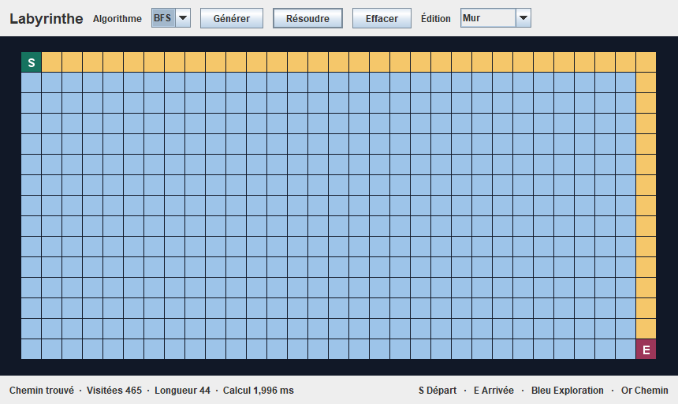
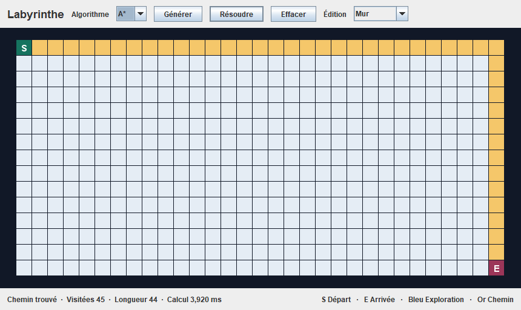

# Solveur et visualiseur de labyrinthes

Projet Java consacré à la génération et à la résolution de labyrinthes. La démonstration console génère un labyrinthe avec une graine fixe et compare trois solveurs.

## Lancement sous Windows

Installez un JDK 17 ou ultérieur et vérifiez que `java` et `javac` sont accessibles depuis le `PATH`. Double-cliquez sur `run.bat` pour compiler les sources dans `bin/` et ouvrir la fenêtre Swing.

1. Cliquez sur **Générer** pour créer un labyrinthe aléatoire.
2. Dans **Édition**, choisissez **Mur** puis cliquez sur une case pour poser ou retirer un mur. Les modes **Déplacer S** et **Déplacer E** placent le marqueur sur une case libre.
3. Choisissez BFS, DFS ou A*, puis cliquez sur **Résoudre**. Les cases explorées apparaissent successivement en bleu, puis le chemin s'affiche en or. Le bandeau affiche le nombre de cases visitées, la longueur en déplacements et le temps de calcul.

**Effacer** retire le résultat en conservant la grille. Modifier la grille ou changer de solveur annule l'animation en cours.

## Architecture

- `model` contient la grille, les cases et le générateur.
- `solver` implémente les trois parcours via `MazeSolver`. `AbstractSolver` partage la reconstruction du chemin et `SearchResult` transmet au visualiseur l'ordre d'exploration.
- `view` contient le rendu dans `MazePanel` et les contrôles dans `MainFrame`. Sur la grille de 15 × 31, le calcul produit un résultat avant l'affichage. Un `javax.swing.Timer` révèle ensuite les cases une à une et affiche le chemin final. Le temps mesuré exclut cette animation.

`S` représente le départ, `E` l'arrivée, `#` un mur et `.` une case libre.

## Modèle

`Cell` conserve ses coordonnées, son type, son état de visite et son parent. `Grid` maintient un départ et une arrivée distincts et renvoie les voisins accessibles dans les quatre directions cardinales. L'état de recherche peut être réinitialisé entre deux résolutions.

## Génération

`MazeGenerator` applique un parcours en profondeur aléatoire avec retour arrière (*Recursive Backtracker*). Depuis la case courante, il choisit une case voisine encore inexplorée, à deux pas, et ouvre le mur entre les deux. Quand il est bloqué, il remonte dans la pile. Chaque nouvelle case se raccorde par un seul passage au réseau déjà creusé, ce qui donne un labyrinthe connexe et sans cycle. [Présentation de l'algorithme par Jamis Buck](https://weblog.jamisbuck.org/2010/12/27/maze-generation-recursive-backtracking).

La génération accepte des grilles d'au moins 3 × 3, paires ou impaires. L'arrivée occupe la dernière case du réseau, aux coordonnées paires en bas à droite. Une dernière ligne ou colonne de murs complète les dimensions paires. Un générateur aléatoire fourni par l'appelant permet de reproduire un labyrinthe à partir d'une graine fixe.

## Résolution

`MazeSolver` définit le contrat de résolution. `AbstractSolver` reconstruit le chemin en remontant les parents et `SearchResult` conserve l'ordre d'exploration, le chemin et le temps de calcul. La longueur du chemin compte les déplacements et vaut `-1` lorsque le résultat est vide.

- **BFS** explore par couches avec une file FIFO. Le prototype s'arrêtait après les voisins immédiats du départ et échouait sur `S.E`. L'exploration des voisins a été déplacée dans la boucle. Chaque case est marquée dès son ajout, ce qui évite les doublons et garantit un plus court chemin quand chaque déplacement coûte une unité.
- **DFS** explore en profondeur avec une pile. Il marque chaque case lors de sa première extraction et ignore les entrées devenues redondantes. Le chemin trouvé dépend de l'ordre des voisins et peut être plus long que celui de BFS.
- **A\*** donne la priorité au plus petit score `f(n) = g(n) + h(n)`, où `g` est le meilleur coût connu depuis le départ et `h` la distance de Manhattan jusqu'à l'arrivée. Un déplacement orthogonal coûte une unité et fait varier `h` d'au plus une unité. Cette cohérence garantit un plus court chemin lorsque l'arrivée est extraite. À score égal, le comparateur privilégie la plus petite distance de Manhattan. [Notes du cours CS221 sur A*](https://web.stanford.edu/~shervine/teaching/cs-221/cheatsheet-states-models/).

Si un meilleur coût est découvert, le solveur retire la case de la `PriorityQueue<Cell>` avant de modifier sa priorité, puis la réinsère. La recherche de cette case dans la file coûte un temps linéaire. [Documentation Java 17 de PriorityQueue](https://docs.oracle.com/en/java/javase/17/docs/api/java.base/java/util/PriorityQueue.html).

## Comparaison console

Lancez `run.bat --no-pause --console` pour reproduire la comparaison. Chaque algorithme résout les mêmes deux grilles de 15 × 31. Une case compte comme explorée lors de son extraction pour traitement, arrivée incluse. Une exécution a donné les résultats suivants.

| Grille | Algorithme | Cases explorées | Déplacements | Temps (ms) |
| --- | --- | ---: | ---: | ---: |
| Labyrinthe, graine 42 | BFS | 195 | 136 | 1,535 |
| Labyrinthe, graine 42 | DFS | 189 | 136 | 0,513 |
| Labyrinthe, graine 42 | A* | 193 | 136 | 14,614 |
| Grille ouverte | BFS | 465 | 44 | 0,608 |
| Grille ouverte | DFS | 45 | 44 | 0,082 |
| Grille ouverte | A* | 45 | 44 | 1,353 |

Sur la grille ouverte, A* suit un plus court chemin grâce à Manhattan et au départage en faveur de la case la plus proche de l'arrivée. Les détours du labyrinthe limitent ce gain. Les temps sont ceux d'une exécution sans échauffement de la JVM. Ils varient selon la machine et reflètent aussi le coût de la file de priorité.

## Captures BFS et A*

Lancez `run.bat --open-grid` pour ouvrir la même grille libre de 15 × 31. Les deux solveurs trouvent un chemin de 44 déplacements. BFS explore 465 cases et A* en explore 45.

**BFS**



**A\***



## Tests

Depuis l'invite de commandes Windows, exécutez ces commandes à la racine du dépôt avec un JDK 17 ou ultérieur.

```bat
run.bat --no-pause --console
java -cp bin test/SolverTest.java
```

Les trois tests vérifient le chemin au-delà de la première couche (`S.E`), l'arrivée bloquée puis rouverte (`S#E`), et le contournement d'un mur. Le dernier test exige aussi un plus court chemin de huit déplacements pour BFS et A*.
